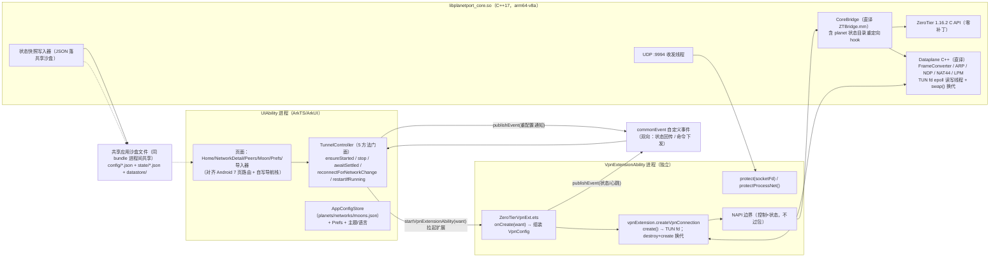

# Planet Port · HarmonyOS 迁移深度调研与可行性评估

> 调研日期：2026-10-28
> 调研范围：可行性结论 / 平台能力 / 架构设计 / 技术选型 / 风险与验证计划 / 工作量估算
> 迁移标准：对齐 iOS → Android 的实际交付基线（见 §1）
> 目标仓库：planet-port/planet-port-harmony（占位已建）

---

## 0. 结论（TL;DR）

**技术上可行，置信度高；推荐原生方案（ArkTS UI + C++ 核心/数据面），架构对齐 iOS 双进程模型。**

四条关键依据：

1. **平台 VPN 能力完整存在且公开开放**。HarmonyOS NEXT 提供 `VpnExtensionAbility`（三方 VPN 扩展进程）+ `@ohos.net.vpnExtension` API：创建 TUN 虚拟网卡（返回 fd）、配置地址/路由/DNS/MTU、按包名分流、socket 级 `protect()` 防回环——与 iOS `NEPacketTunnelProvider` / Android `VpnService` 原语一一对应。**无需任何 ACL 特权权限**，仅需 `INTERNET` + `GET_NETWORK_INFO`，VPN 授权走系统用户确认弹窗（先例工程 `module.json5` 实证）。
2. **ZeroTier C++ 核心已被验证能在鸿蒙 NDK 编译运行**。HarmonyRun/ZeroTier-HarmonyOS 已将 ZeroTier 1.14.2 官方源码用 OHOS NDK（arm64-v8a，musl）编译通过，经 NAPI 接入 VpnExtensionAbility，产物约 1.1 MB .so。我们用的 1.16.2 无新增平台依赖。
3. **同类 mesh VPN 应用已上架 AppGallery**。MeshArc（Tailscale 社区客户端，Go 内核 + VpnExtension）已在华为应用市场上架运营，证明"原生内核 + 三方 VPN"这条路不仅技术上通，分发上也走得通（见 §3.6 的审核现实）。
4. **自研代码的绝大部分是平台无关纯逻辑**。数据面（ARP/NDP/NAT44/LPM/路由数学）、ZTQR1 传输协议、配置存储模型均为直译级可移植资产，且 iOS / Android 双版本已互为行为规格（见 §2.3）。

三个必须正视的现实（均非阻断项）：

- **分发有门槛**：AppGallery 中国区上架 HarmonyOS 应用需软件著作权证书，且 VPN 类目为个案审核；兜底路径是 GitHub Releases + hdc 侧载（开发者模式）。
- **两项功能降级**：无 Connect On Demand 等价物（重启手机后需手动打开 App 重连）；系统单 VPN 互斥（与 iOS 相同）。
- **若干平台行为需真机验证**（protect 对 native fd 的接受度、扩展进程后台存活性、DNS 不配置时的回退行为等），已整理为 1–2 周的 Spike 计划（§6），通过后再进入正式开发。

---

## 1. 迁移标准（对齐 iOS → Android 的交付基线）

Android 版定义并实践了迁移范式，鸿蒙版沿用：

| 标准项 | Android 版做法 | 鸿蒙版要求 |
|---|---|---|
| 核心来源 | ZeroTier 官方 1.16.2 tarball，SHA256 锁定，bootstrap 拉取不入库，**零本地补丁** | 同 |
| 许可红线 | "GPL 血统零引入"（禁参考 GPL 分支项目，如 kaaass/ZerotierFix——GPLv2 血统）；核心 MPL 2.0 部分原样编译，nonfree/（controller）不参与 | 同；自研代码 MIT |
| 功能对齐 | 多 Planet 并存 / 多网络同时连接（软上限+冲突检测）/ 默认路由与 DNS 三模式隧道内热重配 / Moon / 保持在线 / 主题定制 / 三语 | 同 |
| UI | 原生（Jetpack Compose），无遥测 | 原生 ArkUI |
| 方法论 | **iOS 代码是行为规格，不是拷贝源**；平台差异项重写 | 同 |
| 行为规格源 | planet-port-ios | planet-port-ios（隧道语义）+ planet-port-android（数据面领先项，见 §2.2） |

Android 版隧道层同时是"平台差异知识库"：`docs/superpowers/plans/2026-10-23-p2-tunnel-core.md` 的组件映射表、`ZT_jniguard`（未 attach 线程回调崩溃）、`Dataplane.swap()`（TUN fd 换代并发安全）等教训对鸿蒙直接适用。

---

## 2. 现有资产盘点

### 2.1 iOS 版平台依赖面（摘要）

自研代码 **8,480 行 Swift 产品代码（另 120 行测试）+ 529 行 OC++ 桥接**；ZeroTier 1.16.2 核心约 4.28 万行 C++ 由 bootstrap 拉取，以纯 C API 驱动（`Core/osdep` 仅用 5 个头文件 + 跨平台 OSUtils.cpp，无平台专属 .cpp 编入）。

| 分层 | 内容 | 规模 | 鸿蒙迁移性质 |
|---|---|---|---|
| UI（PlanetPort/） | SwiftUI 21 个 View + 主题 + 蜂窝权限检测 | 5,137 行 | **重写**（ArkUI） |
| 隧道（PlanetPortTunnel/） | PacketTunnelProvider + FrameConverter/NAT44/ARPTable/NDPTable/NetworkContext/RoutePlanner | 1,922 行 | 语义直译；数据面进 C++ |
| 共享（Shared/） | Models/AppConfigStore/StatusStore/AppGroup/Localization | 671 行 | 直译（IPC 载体更换） |
| QRTransfer 模块 | ZTQR1 分帧协议（Deflate+Base45+CRC32） | 750 行 | 直译 ArkTS |
| 桥接（ZTBridge/） | OC++ 包装 C API + planet 状态目录重定向 hook | 529 行 | **直译为 C++**（hook 逻辑平台无关） |

关键机制（鸿蒙需找等价物，详见 §4.4）：

- IPC 三件套：App Group 共享容器 + Darwin 通知（双向无 payload 唤醒）+ `sendProviderMessage`（同步查询 peers/status/networkConfig）。
- 数据面：单 TUN 多网络 LPM 选网、ARP/NDP 软件表、NAT44 源地址改写（512 条 LRU）、物理网段挖洞（前缀差集二分展开）、45s ARP 保活。
- 默认路由：`excludedRoutes` 在 iOS 亦被规避，实际实现就是挖洞差集（`PacketTunnelProvider.swift:395-398` 注释明言分流场景下 excludedRoutes 是未定义行为）——**该实现方式天然适配鸿蒙**（鸿蒙无 excludedRoutes 概念）。
- DNS 三模式：全部经 `NEDNSSettings` 系统层设置，无隧道内 DNS 代理。
- 保持在线：`NEOnDemandRuleConnect`（**鸿蒙无等价物，功能降级**）。
- Planet 状态隔离：`ZTBridge.mm` 的 `ztHookedPath()` 把 PLANET/MOON/PEER/NETWORK_CONFIG 状态对象按 `planet_active_id` 重定向到 `planet-state/<planetId>/` 子目录——纯 C++ 逻辑，直译。

### 2.2 Android 版迁移实操数据（工作量的锚）

v1.3.0 实测：Kotlin 自研 **14,651 行**（ui 10,361 / tunnel 3,060 / store 918 / qrtransfer 305）+ 官方 JNI 绑定 2,707 行原样复用（另自研 112 行守卫代码 + 7 行适配修改）+ 构建胶水 246 行（gradle×3 + CMakeLists）。

对鸿蒙最有价值的 Android 领先项：

| 项 | Android 实现 | 鸿蒙复用方式 |
|---|---|---|
| TUN fd 换代 | `Dataplane.swap(fd)`：独立读写线程、防 GC finalizer 关 fd、换代 join 防读线程 UAF、配置签名幂等闸门 | **直接照搬**（鸿蒙热重配 = destroy+create 换 fd，见 §4.4-D3） |
| 回调线程安全 | 官方 JNI `GETENV` 在核心自有原生线程回调时崩溃 → RAII attach 守卫 | C++ 侧无此问题（无 JVM）；但"回调线程约束"设计意识保留 |
| NDP 领先实现 | ICMPv6 伪头校验和、真实源地址 NS、DAD 回全节点组播 NA（iOS 侧尚欠同步） | C++ 数据面**以 Android 版为规格** |
| protect 防回环 | UDP socket bind 后立即 `vpnService.protect()`（`2026-10-23-p2-tunnel-core.md` 硬约束 #3） | 鸿蒙对应 `VpnConnection.protect(fd)` / `protectProcessNet()` |
| 切网自愈 | NetworkRequest 回调 + 自建候选物理网络表（避开 activeNetwork=自家 VPN 的陷阱）+ 防抖 1.5s + 整核重启 + 代际计数防误启 | 逻辑直译；监听源换 `@ohos.net.connection` |
| 配置驱动 | TunnelController 实际收敛为 5 个方法；join/leave/orbit 等下沉到 `TunnelManager.applyConfig()` level-triggered 读文件现算差分 | **沿用该范式**（跨进程下 level-triggered 比命令式更稳） |
| 差异项 | "保持在线"偏好有消费方（App 启动时自动恢复隧道，HomeViewModel.kt:124-140），仅缺系统级开机自启（无 BOOT_COMPLETED receiver） | 鸿蒙可直接对齐此行为：打开 App 即自动恢复；开机自启两端皆无 |

### 2.3 可移植资产清单（直译级）

- 数据面纯算法：FrameConverter（380 行）/ NAT44（177）/ ARPTable（68）/ NDPTable（92）/ NetworkContext + 路由数学（LPM 聚合、冲突检测、前缀差集挖洞）——Swift 与 Kotlin 双实现互为校验，C++ 化时逐文件对齐。
- 配置模型：planets.json / networks.json / moons.json 的 Codable 结构与 bootstrap 迁移逻辑。
- ZTQR1 协议：Base45/CRC32/ChunkPlanner 纯算法；Deflate 换 zlib（鸿蒙 NDK musl 自带）。
- 主题系统：主色派生状态色/行星装饰盘的取色算法。
- 三语资源：主目录 337 个 string key（zh-Hans / zh-Hant / en；含 InfoPlist/QRTransfer 目录合计 356），直接转为鸿蒙 resources 多语言目录。

---

## 3. 鸿蒙平台能力调研

### 3.1 三方 VPN 机制全景

架构：`VpnExtensionAbility`（Stage 模型 extension，**独立系统进程**，`module.json5` 中 `extensionAbilities[].type = "vpn"` + metadata `ohos.ability.vpn_extension`）→ UIAbility 侧 `vpnExtension.startVpnExtensionAbility(want)` 启动 → 扩展内 `createVpnConnection(context)` → `VpnConnection.create(VpnConfig)` 返回 **TUN fd**。

`VpnConfig` 关键字段（官方 API 参考，2026-04 版）：

| 字段 | 约束 | 对 Planet Port 的意义 |
|---|---|---|
| addresses | LinkAddress[]；API 23 前 ≤64，之后 ≤2000 | 多网络聚合地址（v4+v6 混排） |
| routes | RouteInfo[]；API 23 前 ≤1024，之后 ≤10000；`isDefaultRoute` 标记默认路由 | ZT 下发路由 + 默认路由 + **挖洞差集展开**（几十条，余量充足） |
| dnsAddresses | string[] | DNS 三模式（见 §4.4-D6） |
| mtu | **[576, 1500] 硬区间** | ZT 默认 2800 不可用，取 ≤1500（性能微降，无功能影响） |
| isIPv4Accepted / isIPv6Accepted | 默认 true / false | IPv6 开关映射"禁用 IPv6"偏好 |
| trustedApplications / blockedApplications | 包名级分流（互斥，API 23 前 ≤64） | 本期不用，保留为 per-app 分流扩展点 |

`VpnConnection` 方法面：`create` / `destroy` / `destroy(vpnId)`（API 20+）/ `generateVpnId`（API 20+，多 VPN 仅 IPv4）/ `protect(socketFd)` / `protectProcessNet`（API 22+，进程级绕过 VPN）。**没有 update 接口**——热重配语义见 §4.4-D3。

注意事项（官方文档明载）：扩展进程内不得引用联系人/位置/音频/相机/电话/短信等模块；错误码 2203001 表明部分受限用户类型会被拒绝建 VPN（官方原文仅提示 "check the user type"）。

### 3.2 权限与授权

- 常规权限即可：`ohos.permission.INTERNET` + `ohos.permission.GET_NETWORK_INFO`（先例工程 module.json5 实证，无 ACL 申请、无 system_basic 权限）。
- VPN 启动时系统弹用户授权确认（同 iOS "Add VPN Configuration" / Android VpnService.prepare 对应物）。
- 个人华为开发者账号 + DevEco 自动签名即可真机调试 + hdc 安装（先例路径实证；账号是否免费以华为开发者联盟现行政策为准）。

### 3.3 API 版本基线

| HarmonyOS 版本 | API | 关键增量 |
|---|---|---|
| NEXT 5.0.0（2024Q4） | 12 | VpnExtensionAbility / vpnExtension 模块可用（模块首批 API 11 起） |
| 5.1.0 | 18 | — |
| 6.0.0（2026 年初） | 20 | `destroy(vpnId)` / `generateVpnId` |
| 6.0.2 | 22 | `protectProcessNet()`（进程级防回环） |
| HarmonyOS 6 / 6.1（2026） | 23 | 地址/路由/分流容量扩容；MeshArc 的目标版本 |

**建议基线**：`minAPI 12`（覆盖 5.x 存量，6000 万+ 设备池）+ per-socket `protect(fd)`；`targetAPI 23`；API ≥22 运行时走 `protectProcessNet()` 快路径。若 Spike 证明 per-socket protect 不可行，则 minAPI 提至 22（6.0.2+）作为回退。

**重要约束**：官方文档明载 `startVpnExtensionAbility(want)` 的 **parameters 字段从 API 22 起才支持传参**。minAPI 12 场景下启动配置不能依赖 want 传递——架构上改为扩展进程 `onCreate` 直接读共享沙盒配置文件（见 D5），恰好与 level-triggered 配置范式吻合，且全版本行为一致。

### 3.4 先例工程分析（4 个，各自证明什么）

| 工程 | 内核 | 证明 | 缺口/注意 |
|---|---|---|---|
| **HarmonyRun/ZeroTier-HarmonyOS**（⭐2，2026-08） | ZeroTier 1.14.2 C++ → OHOS NDK arm64，~1.1 MB .so，NAPI 绑定 | ① ZeroTier 核心 musl/NDK 编译可行 ② C API 零修改接入 ③ VpnExtensionAbility + native 的完整骨架（want 传参启动、commonEvent 回传状态、心跳看门狗） | **未在真机完成端到端 ping 验证**；L2/L3 转换用"广播 MAC 封装"取巧（我们用完整 ARP/NDP 表，无需取巧）；多网络只支持首个 UP 网络（我们已有聚合方案）；仅 arm64 |
| **flypigJ/Tailscale-OHOS（MeshArc）**（⭐56） | Tailscale 引擎 1.86.5 + OpenHarmony Go 1.24 工具链 | ① mesh VPN **已上架 AppGallery** 运营中 ② API 23/arm64 日常可用 ③ macOS 构建路径 | 明示限制：MagicDNS 未启用、重启后需手动重连（无开机自启）、系统单 VPN 互斥——三项与我们预判一致 |
| **Henry-Fox/OhosXray** | Xray-core（Go c-shared） | ① VpnExtensionAbility + native 内核全局 TUN **真机验证**（Mate 80 Pro）② 扫码（ScanKit）、切网自动重绑 WiFi↔蜂窝 ③ 大规模国内 CIDR 挖洞分流（route 容量实证） | 明确"VPN/代理类国内上架极难，不走商店"——代理类与 mesh 组网类审核待遇不同 |
| **xiaoli8571/TunBox**（⭐67） | mihomo | mihomo 内核 + 订阅/分流/测速的完整原生客户端存在且活跃 | 侧证生态成熟 |

结论：**没有单一先例覆盖我们的全部需求**（ZeroTier 先例未做端到端真机验证、未做多网络聚合；Tailscale 先例是 Go 内核），但四者拼起来恰好证明每一段路都通。多网络聚合路由 + 完整 ARP/NDP/NAT44 数据面恰好是我们的存量强项。

### 3.5 工具链与 macOS 构建

- DevEco Studio 5.0+（macOS 官方 DMG 安装；Homebrew 无 deveco-studio cask）；NDK CMake 工具链 `ohos.toolchain.cmake`（`-DOHOS_ARCH=arm64-v8a`）。
- 命令行：`hvigorw assembleHap`（Hvigor/Node 运行时随 DevEco 捆绑；先例 BUILD.md 称另需 JDK 17 + Node 18，以官方要求为准），CI 可行（Android 版 build.yml 模式平移）。
- 真机：`hdc`（对标 adb/ideviceinstaller）；签名用 DevEco 自动签名（个人证书）。
- 模拟器对 VpnExtensionAbility 支持存疑，**真机为必需品**（一台 HarmonyOS NEXT 5.x/6.x 华为机）。

### 3.6 分发与上架

| 路径 | 要求 | 现实 |
|---|---|---|
| AppGallery 中国区 | 华为开发者实名认证 + **软件著作权证书**（多方来源一致：鸿蒙应用上架强制）+ VPN 类目个案审核 | MeshArc（Tailscale）已上架 = mesh 组网类可过审的先例；"Planet Port" 定位为异地组网/远程访问工具而非"VPN 加速"，与 Tailscale 同类。软著办理需数周，可与开发并行 |
| GitHub Releases + hdc 侧载 | 用户开开发者模式 + USB 安装 | OhosXray 验证可行；开源社区用户可接受；签名证书有有效期需续 |
| 海外区 AppGallery | 要求以 AGC 各区文档为准 | 跟随主仓库策略（iOS/Android 版本目前也未上任何商店，仅 GitHub 分发，压力不大） |

**软著数量澄清**（2026-10-28 补充，华为/小米/荣耀官方 FAQ 口径）：软著按"商店应用条目"计而非按平台计——证书登记的是"软件名称+版本"，无平台字段；华为要求证书名称/简称与应用名称一致，小米/荣耀明确一个软著只对应一个应用。因此：现阶段仅鸿蒙版上 AppGallery，**办一份即可**（名称不带平台后缀，如"Planet Port 软件 V1.0"，给将来 Android 条目留出主名称）；iOS/纯 GitHub 分发不需要软著。官方登记（中国版权保护中心）免费、周期约 30–60 个工作日，材料为源代码前后各 30 页 + 说明文档；急用可走电子版权认证证书（数天～两周，收费，华为认可）。著作权人须与开发者账号实名主体一致。

**"各平台代码不同，为何不用分别登记"**：著作权自动产生，登记是形式审查（不比对、不存档代码），商店审核也只验名称与主体、不验代码——证书在整条链路里只是"上架门票"。权属证明层面，开源仓库的公开 git 历史（时间戳 + 署名）本身就是最强创作证据。仅当涉及软件资产转让、第三方授权或公司 IP 尽调时，才值得按平台分别登记（且名称必须带后缀区分，不能与首份重复）。

**登记时机建议**：不必等鸿蒙代码完成——**现在即可用现有 iOS 代码提交登记**（名称"Planet Port 软件 V1.0"、平台中立、著作权人与开发者账号实名一致、说明文档按产品功能写而非 iOS 专属），把 30–60 个工作日的行政周期与鸿蒙开发并行，App 完成时证书已到手。

### 3.7 市场背景（简）

Counterpoint（二级来源转引）：2026Q1 鸿蒙在中国智能手机 OS 份额 19%、iOS 17%；截至 2026 年 5 月 HarmonyOS 5/6 终端突破 6000 万台（二级来源，无法独立核实）。19% 含老版本鸿蒙，与本项目直接相关的是 5.0+（NEXT，API 12 起）存量。目标用户群（自建 Planet 的极客/团队）中华为设备占比存在真实需求。

---

## 4. 架构与技术选型（深入分析）

### 4.1 候选架构对比

| 方案 | 描述 | 优势 | 劣势 | 结论 |
|---|---|---|---|---|
| A. 全 ArkTS（含数据面） | 核心 NAPI 薄暴露，TUN 读写与帧转换在 ArkTS | 与 ZeroTier-HarmonyOS 同构，先例代码可参考 | 每个包跨 NAPI 边界（序列化开销）；ArkTS GC 参与包处理路径；数据面第三次用动态语言重写；帧循环依赖 ArkTS 定时器 | 弃 |
| B. **ArkTS 壳 + C++ 核心&数据面** | ZeroTier C API、UDP、TUN I/O、ARP/NDP/NAT44/LPM 全在 .so；ArkTS 只做 UI/生命周期/授权/配置组装 | NAPI 边界**只过控制流与状态流，不过包**；数据面性能与 Android/iOS 对等甚至更好；Swift→C++ 直译保真度高（同为静态类型）；数据面 C++ 化为未来三端统一留路 | 比 A 多一层 NAPI 设计；C++ 侧需自建线程/锁纪律（对齐 ZTBridge 串行队列模式） | **选** |
| C. 跨平台 UI（Flutter OHOS / uni-app） | UI 层复用 | — | VpnExtensionAbility 只能 ArkTS 写，必然双语言；Flutter OHOS 为社区维护分支，跟随官方 API 滞后风险；与"首选原生"冲突；iOS/Android 兄弟版本皆原生，一致性差 | 弃 |

选 B 的决定性理由：VPN 应用的性能敏感路径就是包处理，ArkTS 在这条路径上只应出现两次——`create()` 拿 fd、`protect()` 标记 socket。

### 4.2 推荐架构总图

> 注：`startVpnExtensionAbility` 的 `want.parameters` 从 API 22 起才支持传参（官方文档明载）。**配置主路径 = UI 先写共享沙盒 `config/*.json`，再拉起扩展，扩展 `onCreate` 自行读文件**——不依赖 want 传参，全版本行为一致，且与 D5 的 level-triggered 范式天然统一。先例工程经 want 传参的方式在其 API 20 目标上是否真实生效存疑，不采用。

### 4.3 组件映射表（iOS → HarmonyOS）

| iOS | HarmonyOS 等价物 | 备注 |
|---|---|---|
| NETunnelProviderManager / VPNManager | TunnelController（ArkTS）+ startVpnExtensionAbility(want) | 拉起扩展；配置经共享沙盒文件（want.parameters 仅 API≥22 可传，不作依赖） |
| NEPacketTunnelProvider | VpnExtensionAbility（type=vpn） | 独立进程，同 iOS 扩展 |
| packetFlow.readPackets / writePackets | native read()/write() TUN fd（epoll 线程） | 性能更优 |
| setTunnelNetworkSettings（可重复调用） | VpnConnection.create(VpnConfig)；**无 update** | 热重配 = destroy+create（D3） |
| App Group 共享容器 | 同 bundle 应用沙盒目录（进程间共享）+ preferences | 不再有 entitlements 配置 |
| Darwin 通知（无 payload 唤醒） | commonEventManager 自定义事件 | 可携带 payload，更强 |
| sendProviderMessage 同步查询 | 状态快照 JSON + 事件触发重读 | level-triggered（Android 范式） |
| ZTBridge.mm（OC++） | CoreBridge.cpp | 直译，含 ztHookedPath |
| utun | VpnConnection.create 返回 fd | — |
| NEOnDemandRuleConnect | **无等价物** | 降级：切网监听重连；重启后手动 |
| NWPathMonitor | @ohos.net.connection 回调 | 判定逻辑直译（防抖/代际计数保留） |
| NEDNSSettings | VpnConfig.dnsAddresses | 三模式见 D6 |
| excludedRoutes（未用，已挖洞实现） | 无此概念，routes 差集展开 | iOS 实现直接复用 |
| —（Android: VpnService.protect） | VpnConnection.protect(fd) / protectProcessNet() | D4 |
| AVCaptureSession 扫码 | ScanKit（支持相册） | 权限模型更简单 |
| CIQRCodeGenerator | @ohos.multimedia.scanCore generateBarcode | — |
| Compression（Deflate） | zlib（NDK musl） | 字节兼容需回归验证 |
| os.Logger / NSLog | hilog | — |
| xcstrings 三语 + 运行时切换 | resources 多语言目录 + 自研查表（LanguageManager 模式） | 沿用 iOS 方案而非系统 locale 强绑 |
| xcodegen / project.yml | DevEco 工程 + build-profile.json5 + hvigorw | — |
| XCUITest 取证 | hdc + hilog（+ ArkTS 单测框架按需） | 真机日志为主 |

### 4.4 关键设计决策

**D1 进程模型：核心必须在扩展进程（对齐 iOS，非 Android）。**
TUN fd 不跨进程传递，`createVpnConnection` 需 `VpnExtensionContext`——ZeroTier 核心、数据面、UDP 全部宿主在 VpnExtensionAbility 进程（独立 OS 进程，先例 `ZeroTierVpnExt.ets` 注释明言）。Android 版的 TunnelStateBus 进程内热流退化为 iOS 式跨进程契约：**快照文件 + 事件唤醒**。UI 进程死亡不影响隧道（扩展进程存活），反向依赖（扩展死了 UI 看门狗拉起）用先例的心跳方案（15s 超时 + 10s 冷却重启）。

**D2 NAPI 边界设计：三个函数族，零包路径。**
① `start(tunFd, config) / stop() / shutdown`；② `protectRequest` 回调（native 新建 UDP socket 后把 fd 送 ArkTS 调 `VpnConnection.protect`，或 API≥22 时一次性 `protectProcessNet` 后跳过）；③ 状态导出 `snapshot() → JSON`（节点/peers/网络状态/诊断计数，节流落盘）。对齐 Android 官方 JNI 18 个入口的克制面，不自造大接口。

**D3 热重配：destroy + create 同进程换代（核心不重启）。**
VpnConnection 无 update 接口；网络配置变化（join/leave/路由/DNS 变更）= `destroy()` → `create(新 VpnConfig)` → 新 fd → `Dataplane.swap(fd)`（Android 已验证的换代方案：独立读写线程、join 防 UAF、配置签名幂等闸门避免无谓 swap）。核心进程与 ZT 会话全程存活，对齐 iOS "隧道内热重配，无需重连"的既定体验。需真机观察两点：授权弹窗是否复现、换代瞬断时长（Spike S4）。

**D4 防回环（protect）：双轨。**
首选 `protectProcessNet()`（API 22+，扩展进程整体走物理网络，一次调用）；API <22 回退 per-socket `protect(fd)`（native 创建的 fd 传给 ArkTS 调用——fd 为进程内整数，理论可行，**spike 必验**）。若两者皆不顺，终极回退是 minAPI 提 22。

**D5 配置传递与命令通道：共享沙盒文件 + commonEvent + level-triggered 全量重读。**
初始配置：UI 先写 `config/*.json` 再拉起扩展，扩展 `onCreate` 读文件组装 VpnConfig（`want.parameters` 仅 API 22+ 可传，不作依赖，理由见 §3.3）。运行中变更：扩展进程订阅自定义命令事件（如 `CONFIG_CHANGED`），收到后重读配置文件并现算差分（join/leave/orbit/DNS）——完全复用 Android `TunnelManager.applyConfig()` 范式，放弃 iOS 时代的逐条命令 RPC。风险（扩展进程事件到达率）在 Spike S4 验证；兜底：重配置退化为 D3 换代或扩展重启。

**D6 DNS 三模式。**
`network` 模式：核心下发的 DNS 填入 `VpnConfig.dnsAddresses`，系统解析器向其发起的查询流量按路由进入 TUN，由数据面转给核心（与 Android 版行为同构）；`custom`：用户列表；`none`：不设置 dnsAddresses 时系统回退行为**需真机确认**（Spike S4，预期回退物理 DNS，若回退行为异常则以 blockedApplications 方案兜底或文档化限制）。多网络同连时 iOS 版策略是"不设 DNS"，沿用。

**D7 默认路由与挖洞。**
默认路由 = routes 含 v4/v6 默认前缀（`isDefaultRoute`）；allow-lan 挖洞 = 物理网段前缀差集展开为更细前缀加入 routes（iOS `RoutePlanner.expand*` 数学直译；物理接口枚举从 `getifaddrs` 换 OHOS 等价物）。多网络时默认路由强制关闭（iOS 既有规则，沿用）。

**D8 MTU 与地址聚合。**
MTU clamp 至 1500（多网络取最小值逻辑保留）；v4/v6 地址聚合进单 VpnConfig（API 23 前 ≤64 地址、≤1024 路由，实际用量 <20 条，余量充足）。

**D9 保活与自愈。**
扩展进程内存活由系统随 VPN 生命周期保障（MeshArc 日常使用佐证）；网络切换：扩展进程内 `@ohos.net.connection` 注册回调 → 判定逻辑直译 iOS `handlePathUpdate`（基线记录/防抖 1.5s/整核重启/代际计数）；45s ARP 保活沿用；心跳事件 + UI 侧看门狗沿用先例。**无开机自启**（重启后用户手动打开 App）——设置页"保持在线"文案需相应调整。

**D10 安全。**
`identity.secret` 等核心状态落扩展沙盒内 datastore（ZTBridge chmod 0600 逻辑直译）；planet-state 按 Planet 分目录隔离逻辑直译；无需 Keychain（iOS 版本也未用）。

### 4.5 技术选型清单

| 组件 | 选型 | 备选与否决理由 |
|---|---|---|
| UI 语言/框架 | ArkTS + ArkUI（声明式） | SwiftUI/Compose 同构；跨端方案见 §4.1-C |
| 核心/数据面 | C++17，OHOS NDK（llvm/musl），CMake `ohos.toolchain.cmake` | 与 iOS（Xcode）/Android（NDK clang）同构 |
| NAPI 绑定 | 手写（Node-API，对齐官方 JNI 18 入口的克制面） | 无官方 ZeroTier NAPI 绑定（Android 官方 JNI 2,707 行白捡的优势不复存在，净增 ~500 行） |
| IPC | commonEventManager + 共享沙盒 JSON | UDS 需双端 native 不值；RPC/ServiceExtensionAbility 面向系统应用 |
| 网络监听 | @ohos.net.connection | — |
| HTTP 下载（Planet URL 导入） | @ohos.net.http | — |
| 持久化 | JSON 文件 + @ohos.data.preferences | 沿用现有模型，不引 DB |
| 扫码 | ScanKit | 先例（OhosXray）真机验证 |
| 码生成 | @ohos.multimedia.scanCore | — |
| 压缩 | zlib（musl） | Deflate raw 模式字节兼容（Android 版已趟过） |
| 日志 | hilog + 自研滚动诊断日志 | — |
| i18n | resources 三语目录 + 运行时切换查表 | 沿用 iOS LanguageManager 模式，避开系统 locale 强绑 |
| 状态管理 | @State/@ObservedV2 | 对应 SwiftUI @Observable |
| 导航 | 自写页面栈（NavStackViewModel 模式平移） | 不引 Navigation 库（Android 版同策略） |
| 构建/CI | DevEco + hvigorw + bootstrap.sh（tarball/SHA256/.fetched-tag 全套平移） | CI 用 GitHub Actions macOS runner |
| 最低版本 | minAPI 12 / targetAPI 23，arm64-v8a | x86_64 鸿蒙 PC 延后；protect 失败则 minAPI 22 |
| 测试 | 协议字节兼容回归（Base45/CRC32/Deflate/NAT44 数学，随迁移带入，对齐 Android 先例） | 其余遵循"不主动加测试"惯例 |

---

## 5. 风险清单

| # | 风险 | 等级 | 影响 | 缓解 | 验证 |
|---|---|---|---|---|---|
| R1 | AppGallery 审核与软著（非技术） | 中高 | 分发面收窄 | 以"异地组网/远程访问"定位过审（援引 MeshArc 先例）；软著提前并行办理；GitHub Releases + hdc 侧载兜底 | 提审实测 |
| R2 | native fd 传 `protect()` 被拒 | 中低 | 需提 minAPI 至 22 | API≥22 用 `protectProcessNet()` | Spike S2 |
| R3 | 扩展进程收 commonEvent 不稳 | 中 | 热重配退化 | D3 destroy+create 换代兜底；再退化为扩展重启 | Spike S4 |
| R4 | 扩展后台存活性（锁屏/休眠/长期挂机） | 中 | 掉线 | 心跳看门狗 + 切网自愈；MeshArc 日常可用佐证 | S5：24h 挂机 + 锁屏/切网/杀 App 矩阵 |
| R5 | dnsAddresses 置空回退行为不符预期 | 低 | "不使用 DNS"模式语义 | 文档化限制或 blockedApplications 方案 | Spike S4 |
| R6 | destroy+create 换代闪断/重弹授权 | 低 | 热重配体验 | 观察实测；必要时合并变更节流 | Spike S4 |
| R7 | MTU ≤1500 性能 | 低 | 吞吐微降 | 接受；ZT 路径 MTU 本就常被物理链路限制 | 基准测试 |
| R8 | ArkUI 学习曲线与 UI 体量（~10k 行） | 低（高工时） | 进度 | 与 Compose 迁移同构，有 Android 版逐页规格 | — |
| R9 | 鸿蒙 PC（x86_64）覆盖 | 低 | 形态缺口 | 首发手机/平板；PC ABI 后补 | — |
| R10 | 单系统 VPN 互斥 | 确定 | 与其他 VPN 应用冲突 | 与 iOS 行为一致，文档说明 | — |
| R11 | 无开机自启/无 On Demand | 确定 | 重启后手动重连 | 文案管理预期；开 App 即恢复 | — |

---

## 6. Spike 验证计划（正式开发前，1–2 周）

前置：一台 HarmonyOS NEXT 真机（5.x 或 6.x）+ 个人开发者账号 + DevEco 自动签名。

| # | 验证点 | 验收标准 |
|---|---|---|
| S1 | ZeroTier 1.16.2 C++ 核心在 OHOS NDK（arm64-v8a）编译 + 最小 NAPI 壳 | 编译通过；App 内 startNode/身份生成/核心版本号可读 |
| S2 | VpnExtensionAbility 建 TUN + native fd 直读写 + **protect 双轨验证** | fd 交给 native 后 read/write 收发正常；native 创建的 UDP socket fd 经 `protect()` 后流量不走 TUN（抓包/路由表验证）；`protectProcessNet()` 同验 |
| S3 | **端到端连通**（ZeroTier-HarmonyOS 未走完的最后一步） | 真机连官方 Planet 加入测试网络，与另一 ZT 节点互 ping 双通，IPv4/IPv6 各验一次 |
| S4 | 多地址聚合 + 默认路由挖洞 + DNS 三模式 + destroy/create 换代 + commonEvent 命令通道 + 配置冷启动路径 | 双网络同连 LPM 正确；默认路由下 allow-lan 子网直通；三模式 DNS 行为记录在案；换代无授权重弹、闪断 <2s；CONFIG_CHANGED 事件扩展进程可收；扩展 onCreate 从共享沙盒读配置启动（API 12 真机，不依赖 want.parameters） |
| S5 | 存活性矩阵 | 24h 挂机不掉线；锁屏 8h 恢复；WiFi↔蜂窝切换 10 次自愈；杀 UI 进程隧道存活；重启手机后行为符合预期（手动重连） |

S1–S3 全过 = 可行性实锤（go）；S4–S5 决定架构细节参数（D3/D4/D5 的取舍）。

---

## 7. 工作量估算（以 Android 实测为锚）

| 分区 | 估算 | 依据 |
|---|---|---|
| C++ CoreBridge + 数据面直译 | ~2,000–2,500 行 | ZTBridge 529 + 数据面实测 ~1,200（iOS 六文件 1,196）+ UDP/protect/线程胶水；Swift→C++ 直译保真度高 |
| NAPI 绑定 | ~400–600 行 | 对照 Android 白捡的 2,826 行官方 JNI——鸿蒙无官方绑定，为**相对 Android 的净增项** |
| ArkTS 隧道壳（VpnExtensionAbility + VpnController + IPC + 快照） | ~800–1,200 行 | 先例骨架 ~400 行 + 我们的配置/状态面 |
| ArkUI UI + store | ~10,000–13,000 行 | Android ui+store 实测 11,279 行；SwiftUI→ArkUI 同构 |
| QRTransfer | ~400 行 | Android 版 305 行实证 |
| 脚手架（bootstrap/CMake/签名/CI）+ 文档 | ~400 行 + 文档 | Android 版 260 行胶水实测 |

合计 **14,000–18,000 行新代码**，与 Android 移植（14,651 行 Kotlin + 胶水）同量级。

日历估算（AI 辅助高强度开发，参照 Android 版 2026-10-23 首提交 → 10-28 v1.3.0 tag 的实际节奏）：

- 理想（平台零踩坑）：**3–4 周**到功能对齐。
- 现实（含 Spike、真机行为调试、ArkUI 首次上手）：**5–8 周**。
- 软著办理与上架材料并行（数周行政周期，不占关键路径）。

---

## 8. 里程碑建议

- **M0** Spike（1–2 周）：S1–S5，产出 go/no-go 与架构参数定稿（本文档 D3/D4/D5 升级为定案）。
- **M1** 核心隧道（1–1.5 周）：官方 Planet + 单/多网络 + 聚合路由 + 默认路由挖洞 + DNS 三模式 + 切网自愈 + 最小状态 UI。
- **M2** 功能对齐（1.5–2 周）：多 Planet 存在/切换、Moon、冲突检测、软上限、Peers 页。
- **M3** 体验对齐（1–1.5 周）：完整 UI（对齐 Android 7 页）、主题系统、三语、QRTransfer、导入器（文件/URL/扫码）。
- **M4** 发布（并行）：真机长测、签名发布链（GitHub Releases HAP 先行；软著下来后提审 AppGallery）。

---

## 9. 引用

**官方文档**
- @ohos.net.vpnExtension API 参考（更新 2026-04-24）： https://developer.huawei.com/consumer/cn/doc/harmonyos-references/js-apis-net-vpnextension
- HarmonyOS 版本/API 对照（release notes 路径编码：5.0.0=12、5.1.0=18、6.0.0=20、6.0.1=21、6.0.2=22、6.1=23）： https://developer.huawei.com/consumer/cn/doc/harmonyos-releases/changelogs
- @ohos.app.ability.VpnExtensionAbility： https://developer.huawei.com/consumer/cn/doc/harmonyos-references/js-apis-app-ability-vpnExtensionAbility

**先例工程**
- ZeroTier-HarmonyOS（ZeroTier 1.14.2 + OHOS NDK + VpnExtensionAbility 骨架）： https://github.com/HarmonyRun/ZeroTier-HarmonyOS
- MeshArc / Tailscale-OHOS（已上架 AppGallery 的 mesh VPN）： https://github.com/flypigJ/Tailscale-OHOS （AppGallery: io.github.tailscaleohos）
- OhosXray（VpnExtensionAbility + Xray-core，Mate 80 Pro 真机验证）： https://github.com/Henry-Fox/OhosXray
- TunBox（mihomo 鸿蒙原生客户端）： https://github.com/xiaoli8571/TunBox

**市场数据**
- Counterpoint 2026Q1 鸿蒙中国份额 19% / iOS 17%： https://counterpointresearch.com/cn/insights/global-smartphone-os-market-share 及多家媒体转引（新浪财经/凤凰科技，2026-06）
- HarmonyOS 5/6 终端 6000 万+（2026-05）： 知乎/搜狐科技转引报道

**内部资产**
- planet-port-ios（行为规格源）： /Users/zivyuan/GoziLib/Zerotier/planet-port-ios
- planet-port-android v1.3.0（迁移范式与数据面领先实现）： /Users/zivyuan/GoziLib/Zerotier/planet-port-android
- ZeroTierOne 1.16.2 许可： node/osdep/service 为 MPL 2.0，nonfree/（controller，不参与编译）； https://github.com/zerotier/ZeroTierOne/blob/1.16.2/LICENSE.txt
- AppGallery 软著要求（多方非官方一致，以 AGC 最新审核要求为准）： https://bbs.itying.com/topic/68fc1face0a0e1004d86c455

---

*本文档由 Claude 自主调研生成（2026-10-28），事实均标注来源；结论与架构建议待团队评审。*
*v1.1 修订（同日）：经对抗性事实核查（42 项抽查）修正 8 处错误、收紧 13 处表述；其中 `want.parameters` 仅 API 22+ 可传参的约束触发架构修订——配置传递主路径改为共享沙盒文件（见 §3.3 / D5 / §4.2 注）。*
